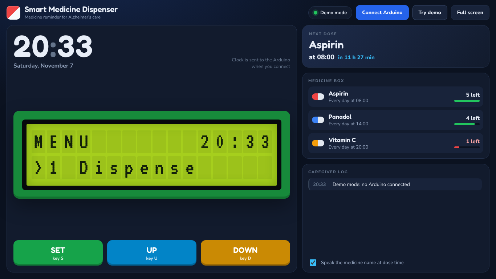
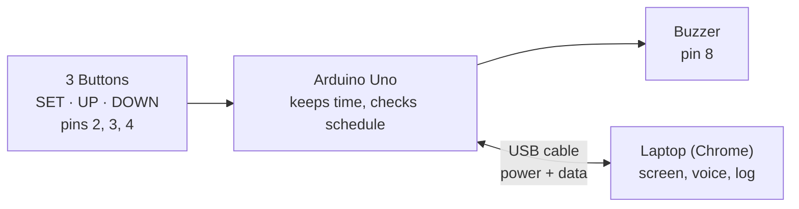
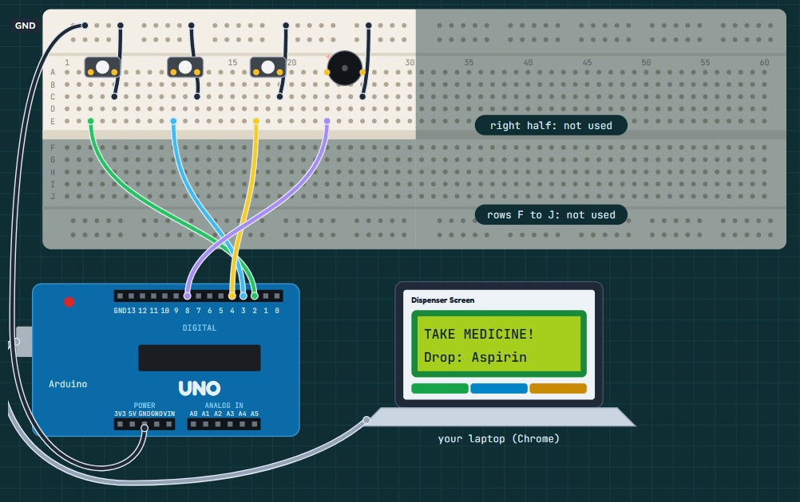

# Smart Medicine Dispenser

A medicine reminder for Alzheimer's patients and older people who forget their medicine. Built with an **Arduino Uno**, three push buttons and a buzzer, using a **laptop as the screen**.

At dose time the buzzer rings, the laptop screen turns red with the medicine name, and the laptop says the name out loud. The pill count goes down and the dose is saved in a log, so the caretaker can see which medicine was taken and when.



---

## The problem

People with Alzheimer's disease slowly lose their memory, and daily medicine is one of the first things they forget. They either miss a dose or forget they already took it and take it again. Older people who take several medicines at different times have the same problem. A caretaker can't be with them all day, and the patient can't rely on their own memory.

## What it does

- Keeps the time for each medicine (default: Aspirin 08:00, Panadol 14:00, Vitamin C 20:00).
- Rings a two-tone alarm on the buzzer at dose time.
- Shows **TAKE MEDICINE** and the medicine name full screen on the laptop.
- Says the medicine name out loud using the laptop's voice.
- Counts the pills left in each compartment and warns when one is empty.
- Keeps a caretaker log with the time of every dose.
- Gets the real time from the laptop when it connects, so the clock is always right.

---

## How it works



The Arduino is the brain. It reads the buttons, keeps the clock and checks every minute if a medicine is due. It doesn't have its own screen; instead it sends the screen text to the laptop over USB, and a page in Google Chrome shows it as a big LCD-style screen. The laptop also sends its real time back to the Arduino.



### Menu

| Option | What it does |
|---|---|
| **1 Dispense** | Normal mode. Shows the next medicine and waits for its time, then rings the alarm. |
| **2 Time Slots** | Change the dose hour of each medicine with UP / DOWN, save with SET. |
| **3 Medicines** | Add or remove pills when refilling the box. |

---

## Hardware

| Part | Qty | Used for |
|---|---|---|
| Arduino Uno R3 | 1 | Runs the program |
| Push button (2-leg) | 3 | SET, UP, DOWN |
| Piezo buzzer | 1 | Alarm sound |
| Breadboard (830 holes) | 1 | Connections without soldering |
| Jumper wires (male–male) | ~9 | Wiring |
| USB A–B cable | 1 | Power and data |
| Laptop with Google Chrome or Microsoft Edge | 1 | Screen |

No resistors are needed. The buttons use the Arduino's built-in pull-up resistors.

### Wiring

| Part | Breadboard holes | To Arduino | Ground |
|---|---|---|---|
| GND line | top edge strip | `GND` | — |
| SET button | A3, A5 | E3 → pin `2` | C5 → GND line |
| UP button | A10, A12 | E10 → pin `3` | C12 → GND line |
| DOWN button | A17, A19 | E17 → pin `4` | C19 → GND line |
| Buzzer | A23 (+), A26 | E23 → pin `8` | C26 → GND line |

Each button connects its pin to GND when pressed. The pin normally reads HIGH (5 V through the pull-up) and LOW (0 V) when pressed.

---

## Getting started

### 1. Install the software
Install **Arduino IDE 2** from [arduino.cc/en/software](https://www.arduino.cc/en/software). No extra libraries are needed.

### 2. Test the hardware (optional but recommended)
The `tests` folder has three small sketches. Upload them one by one to check each part:

| Sketch | Checks | Expected result |
|---|---|---|
| `Test1_Blink` | Board and upload | The L light blinks every second |
| `Test2_Buttons` | Buttons | Serial Monitor (9600) prints `SET pressed`, `UP pressed`, `DOWN pressed` |
| `Test3_Buzzer` | Buzzer | A different beep for each button |

### 3. Upload the main program
1. Open `firmware/SmartDispenser_LaptopScreen/SmartDispenser_LaptopScreen.ino` in Arduino IDE.
2. **Tools → Board → Arduino Uno**, and **Tools → Port →** the port that says *(Arduino Uno)*.
3. Click **Upload**. You'll hear two beeps when it starts.

### 4. Open the laptop screen
1. Close the Serial Monitor (only one program can use the USB port).
2. Open `screen/Dispenser_Screen.html` in **Google Chrome** or **Microsoft Edge**.
3. Click **Connect Arduino**, pick the Arduino's port and click **Connect**.
4. The screen shows **MENU** with your laptop's time.

> Firefox and Safari don't support Web Serial, so the page can't talk to the Arduino there.
> Click **Try demo** on the page to see a sample alarm without any hardware.

### Demo speed

In real use doses are hours apart. To demo it, change this line near the top of the main program and upload again:

```cpp
const unsigned long CLOCK_SPEED = 60;   // 1 second = 1 minute
```

Then use menu 2 to set a medicine one hour after the current clock, choose **1 Dispense**, and the alarm rings in under a minute. Set it back to `1` for real use.

---

## Arduino ↔ laptop messages

They talk over USB serial at **9600 baud**, one text line per message.

**Arduino → laptop**

| Message | Example | Meaning |
|---|---|---|
| `LCD` | `LCD\|MENU       19:40\|>1 Dispense` | The two lines of the screen |
| `MED` | `MED\|0\|Aspirin\|8\|5` | Medicine number, name, dose hour, pills left |
| `ALARM` | `ALARM\|Aspirin` | Dose time |
| `TAKEN` | `TAKEN\|Aspirin\|4` | Dose given, pills left |
| `EMPTY` | `EMPTY\|Panadol` | Compartment is empty |
| `LOG` | `LOG\|Time slots saved` | Text for the caretaker log |

**Laptop → Arduino**

| Message | Meaning |
|---|---|
| `T,19,40,05` | Set the clock (sent on connect and every 10 minutes) |
| `S` / `U` / `D` | SET / UP / DOWN pressed on the page |
| `?` | Send the screen and medicine list again |

---

## Physics behind it

- **Ohm's law (buttons):** a pressed button draws I = V / R = 5 V / 20 kΩ = 0.25 mA through the internal pull-up, far below the 20 mA pin limit.
- **Piezoelectric effect (buzzer):** a changing voltage makes a ceramic disc vibrate and produce sound. The alarm uses 880 Hz and 1320 Hz (λ = v / f = 0.39 m and 0.26 m in air).
- **Serial communication:** 9600 bits/s ÷ 10 bits per character = 960 characters per second.

The full explanation is in [`docs/Project_Explained.pdf`](docs/Project_Explained.pdf).

---

## Project structure

```
smart-medicine-dispenser/
├── firmware/
│   └── SmartDispenser_LaptopScreen/
│       └── SmartDispenser_LaptopScreen.ino   main Arduino program
├── screen/
│   └── Dispenser_Screen.html                 laptop screen (open in Chrome)
├── tests/
│   ├── Test1_Blink/                          board and upload test
│   ├── Test2_Buttons/                        button test
│   └── Test3_Buzzer/                         buzzer test
└── docs/
    ├── images/                               screenshots for this README
    └── Project_Explained.pdf                 full explanation of the project
```

---

## Troubleshooting

| Problem | Fix |
|---|---|
| Upload fails with `stk500_getsync() ... not in sync` | Close and reopen Arduino IDE. Check the port, and keep pins 0 and 1 empty. |
| "Could not open the port" on the screen page | Close the Serial Monitor, or click Disconnect on the page before uploading. |
| A button prints without being pressed | Both legs are in the same breadboard column. Move one leg. |
| Buzzer is silent | Turn it around (the long leg is +). |
| No alarm at dose time | The alarm only rings in **1 Dispense** mode. |

---

## Future work

- A mobile app so the caretaker (son, daughter or nurse) gets a notification at the patient's medicine time and can see which doses were taken or missed.
- A watch or band that reminds the patient even when they are away from the device.
- The whole setup in one box with its own screen, instead of using a laptop.
- For Alzheimer's patients the device can stay very simple, just a buzzer, while all the details go to the caretaker.

---

## License

This project is released under the [MIT License](LICENSE).
